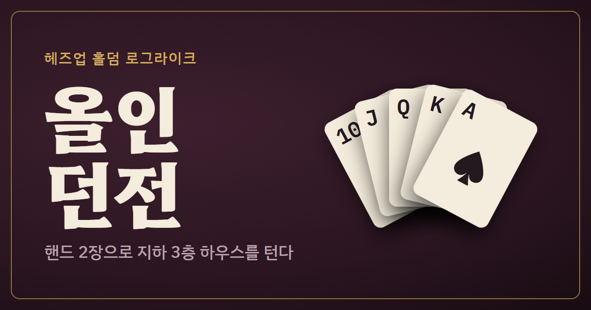

# 올인 던전

핸드 2장으로 지하 3층 하우스를 터는 헤즈업 홀덤 로그라이크 덱빌딩 게임입니다. 폰 세로 화면에 맞춰 만들었고 PC 브라우저에서도 됩니다.

**플레이:** https://thstjdals09-lang.github.io/allin-dungeon/



## 어떤 게임인가

- 손패 5장 중 2장을 핸드로 골라 보드와 합친 족보로 상대와 쇼다운합니다.
- 플롭·턴·리버마다 체크·벳·올인·폴드를 고릅니다. 진 쪽이 족보 값 × 팟만큼 스택을 잃습니다.
- 이기면 카드·유물·트릭·족보 교본으로 덱을 키워 층마다 보스를 넘습니다.
- 진행과 기록은 브라우저(localStorage)에만 저장됩니다.

## 실행과 시험

빌드가 없습니다. `index.html` 을 브라우저로 열면 됩니다.

```
node test.js          # 규칙 시험
node test.js --sim    # 상대별 받는 피해와 베팅 전략 비교(1~2분)
```

## 파일

| 파일 | 역할 |
|---|---|
| `logic.js` | 규칙(족보, 상대, 유물, 지도). 상태를 바꾸지 않는 함수만 |
| `battle.js` | 전투 진행과 전투 화면 |
| `game.js` | 상태, 저장, 상점·보상·휴게실 화면 |
| `events.js` | 이벤트 |
| `meta.js` | 캐릭터, 난이도, 오늘의 도전 |
| `views.js`, `icons.js`, `scenes.js`, `tips.js`, `fx.js` | 화면 조각, 아이콘, 배경, 말풍선, 연출·효과음 |

## 출처

- 아이콘: [Lucide](https://lucide.dev) (ISC License)
- 연출: [anime.js](https://animejs.com) (MIT License)
- 글꼴: Hahmlet, IBM Plex Sans KR, IBM Plex Mono (SIL Open Font License)
